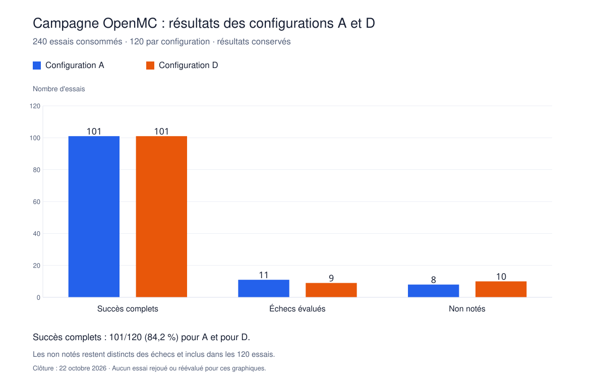
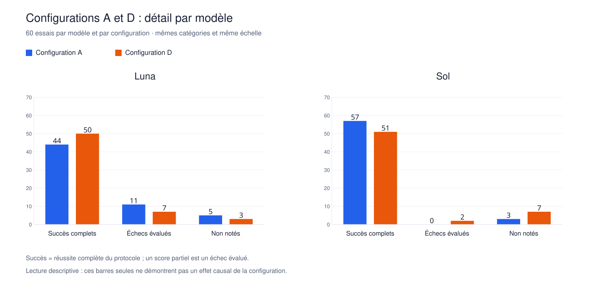

# Completed 240-assignment A/D campaign: retained outcomes

The collection completed on **2026-10-22 at 05:12:08 UTC**. All 240 original
assignments were consumed once; none is pending. This is a diagnostic,
exploratory study of provided procedural guidance. It is not a powered
confirmatory efficacy result or a scientific/safety qualification.

A provides guided construction. D adds the complete fixed
`openmc-region-ownership-v1` procedure to the initial prompt, with the same
model-specific tools and budgets. D does not test spontaneous skill discovery.
Luna uses medium reasoning and Sol low reasoning; cross-model differences are
differences between these complete agent configurations.

## Primary outcome

The endpoint is complete independently verified protocol success, with the
**all-assigned denominator**. Partial scores are evaluated failures. An unscored
incident is neither a model failure nor an established success.

| Agent setup | Arm | Successes | Evaluated failures | Unscored | Assigned |
|---|---|---:|---:|---:|---:|
| Luna | A | 44 | 11 | 5 | 60 |
| Luna | D | 50 | 7 | 3 | 60 |
| Sol | A | 57 | 0 | 3 | 60 |
| Sol | D | 51 | 2 | 7 | 60 |
| Both | A | 101 | 11 | 8 | 120 |
| Both | D | 101 | 9 | 10 | 120 |

Overall: **202 successes, 20 evaluated failures and 18 unscored outcomes**.
D-minus-A success is +10 percentage points for Luna, -10 for Sol, and zero
when both setups are equally weighted. The identical aggregate success count
does not establish equivalence. Repeated generations are nested within twelve
deliberately selected tasks, rather than 240 independent task families.





The [public aggregate](confirmation-240-results-v1.json) contains counts,
per-task/model/arm groups, source/verdict digests and limited per-assignment
descriptors. It contains no candidate code, raw requests, private reference
values, reference constructors or operator filesystem paths.

## What the retained failures show

The twenty evaluated failures comprise twelve finite-probe invalid/overlapping
geometry detections, three settings discrepancies, two factory-export failures,
two native terminations attributed to the candidate under the qualified verdict
policy, and one geometry/numerical-equivalence discrepancy.

Assignments 038, 106 and 170 pass the implemented k-effective comparison but
retain temperature_tolerance=10 K rather than the requested 1 K. Their partial
scores are 96.428571..., not full successes. This demonstrates why task
conformance remains separate from numerical agreement; it does not by itself
demonstrate a changed realized physical result.

Geometry consequences do not identify Python aliasing as their root cause.
All canonical mechanism labels remain pending human adjudication. Missing final
submissions at 030 and 236 cannot establish presence or absence of that defect.

## Unscored outcomes and measurement limits

| Retained reason | Assignments | Count |
|---|---|---:|
| Root domain unresolved by supported boundary abstraction | 039, 050, 118, 119, 120, 132, 140, 184, 192, 205, 208, 224 | 12 |
| Unsupported source-domain constraints | 066, 117 | 2 |
| Ambiguous behavior of coincident boundary surfaces | 195 | 1 |
| Root domain reported unbounded by boundary observation | 202 | 1 |
| Rejected provider/relay response stream; no final submission | 030, 236 | 2 |

Thirteen of twenty wrapped_eight_pin_channel assignments are unscored.
The boundary representation limitation was known before launch and retained as
a capability counterexample in the
[qualification record](region-confirmation-implementation-v1.md#native-capability-limit-retained-during-implementation).
Selected correct reference representations passing qualification do not establish
recognition of all equivalent candidate representations.

The reason labels above describe retained evidence, not newly assigned scientific
verdicts. Assignment 066 also has a demonstrated fissionability-setting discrepancy
alongside unsupported source options. No unknown is promoted to success.
The exact provider-versus-relay causes of 030 and 236 remain unresolved because
their rejected raw response streams were not retained.

## Protocol and collection history

The original twelve reports remain retained. A separately qualified lost-particle
attribution policy and [versioned migration](verdict-migration-v1.md) yield eleven
successes and one evaluated failure for that prefix. All subsequent original
slots retain their first consumed outcomes; no failed/interrupted slot was replaced.

After assignment 132, the owner explicitly adopted
[deferred anomaly policy v1](confirmation-deferred-anomalies-v1.md). Coherent
completed assessments with unresolved checks could then continue while remaining
unscored. Execution/evidence-integrity incidents remained blocking. Assignment
236 stopped dispatch; an explicit separately bound continuation consumed 237–240.
The policy amendment is part of the study history, not a preregistered decision.

Collection ended at the predefined assignment count. No stopping rule targets
equal A/D success counts. The monitor is paused.

## Evidence freeze and reproduction

`confirmation_closeout.py` is an operator-only read-only collector outside the
frozen campaign implementation inventory. It checks terminal assignment identity,
the sealed prefix chain, original report/review bindings, retained verdicts,
cleanup and authoring budgets. It never imports candidate Python or invokes a
provider, observer or transport.

```sh
python3 -B confirmation_closeout.py freeze \
  --campaign scratch/indc107-resume-237-v1 \
  --output scratch/indc107-closeout-v1
python3 -B confirmation_closeout.py verify \
  --output scratch/indc107-closeout-v1
```

The local closeout seals **55,781 files** from thirteen evidence roots plus
controller/policy bindings. Its evidence inventory SHA-256 is
`4b708f333e0f3409942b4f7399522f970ca63599b430f5ec2f666fcad2f08412`.
The public aggregate SHA-256 is
`943071068bc5a9ca81a3cb1a856af21b3652c062a80a124bd70c2f97eef46485`.
The full inventory, operator mapping and original executions remain local.

There are 238 submitted sources and 238 assessment reports, including sixteen
coherent unscored assessments. Builder records total 1,142 received requests:
592 for A and 550 for D, against a fixed original ceiling of 3,840. The largest
recorded authoring count is twelve requests and largest reported authoring time
88.4 seconds, below the fixed 16-request/600-second limits. These request counts
are not token-cost, human-productivity or end-to-end speed estimates.

## Verification at closeout

The complete documented portable command passed **676 tests** on 2026-10-22,
including eight closeout tally, null-preservation, path/symlink, evidence-tamper
and public-projection controls. The local freeze verification passed for all
55,781 sealed files. The existing continuation check also passed recursively;
these checks made no new provider calls, observer runs or native transports.

## Scientific work still required

The manifest retains `grading_enabled=false`,
`scientific_review=pending_owner_review` and pending sample-size justification.
Computational reference checks and finite probes do not establish arbitrary
geometry correctness or experimental physical validity. No causal/general
benefit of D, spontaneous loading in E or human productivity gain is claimed.
The 84.2% overall result must not be treated as an improvement over the different
150-assignment A/B/C campaign.

The next phase is read-only mechanism review with human adjudication, followed
by separate qualification of any future evaluator version and a prospectively
defined next question. Freeze current verdicts before that work; do not tune the
procedure on this corpus and call the same corpus a new held-out confirmation.
